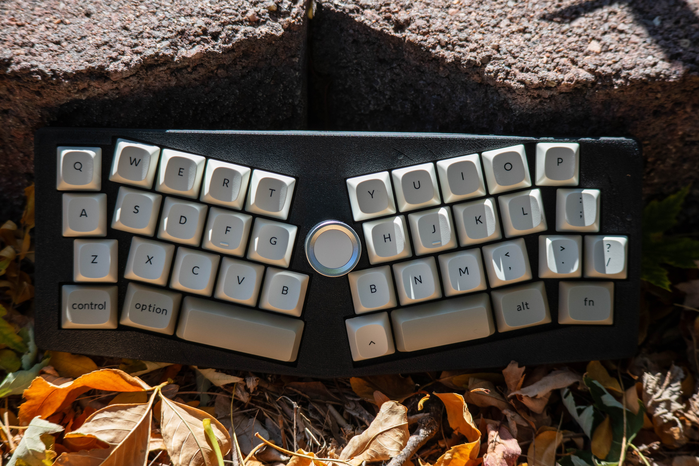

# Brisure

**bri·sure**
/bʁi.zyʁ/
**noun**

1. a break, fracture, or crack; a point or line of division where something splits or folds

[credit](https://www.merriam-webster.com/dictionary/brisure)

***etymology***

From Old French brisor ("a breaking, fracture, or breach"), derived from briser ("to break or shatter"). The word makes frequent appearances throughout historical French literature and biblical translations (e.g., La Sainte Bible rendering "breach", "fracture", or "crushing" as brisure).

For this keyboard specifically, Brisure is a perfect as it references the physical "fracture" of the Alice layout. And its french which is cool.

## Features:
- **37 keys**
- **Alice Layout**
- **Rotary Encoder**
- **Open source** - PCB gerbers + kicad files, case files, ZMK config, and Ergogen YAML

    
    

